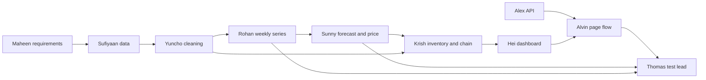

# Project plan

One product in, three answers out: units next week, a price action (hold, mark down, or raise), and a stock alert (reorder, clear, or ok). A manager approves. Nothing changes a live shop.

## Dates

| When | Milestone | Proof |
|---|---|---|
| 15 Nov | One real product runs end to end, and every agent has a test | `pytest` green; golden file matches `expected.json` |
| 30 Nov | Upload, saved runs, and an approval name | Reload the page and the same run is still there |
| 8 Dec | Report (1000 words), 15–25 min recording, final logbook | Submitted |

Phase 2 (many products, competitor prices, fancier forecasts, live price changes) is described in the report only.

## Who depends on whom

Thomas reviews every pull request first. A vague answer goes on the "not yet grounded" list in [PROFILES.md](PROFILES.md) and stays out of the demo until it names a file, a test, or a number.

## Order of work

1. Sufiyaan exports one real product. Rohan checks it has at least 12 weeks.
2. Yuncho freezes the drop rules. Sunny freezes the three price rules as named constants.
3. Thomas freezes the golden file from that product.
4. Alex adds saved runs. Alvin adds upload and the approval name. Hei shows the forecast bar and the checks.
5. Krish keeps the agent order and writes each scope decision in one line.

## Out of scope until the report

Competitor feeds, automatic price changes, a forecast fancier than the four-week mean, and more than one product in one run. The page may show the latest week beside the four-week mean. That is a comparison, not a second model.

## Next on the page

The price is already there. The next work makes a bad file obvious, then makes a run something a manager can save and sign.

### By 15 Nov — the result argues with itself

Proof: the `BREAD-01` / `BREAD01` paste. Today the headline says "Raise to 2.2" and the miss of 225% sits underneath. The 100-unit week is never named as a second code.

1. If the miss is 50% or more, or the last week is far from the three before it, the headline is "Weak guess". The price stays on the page, under that headline.
2. Show two forecasts side by side: the four-week mean, and the latest week alone. On that paste the numbers are 32.5 and 10.
3. Before pricing, list every product code in the file with its row count. If two codes become the same once spaces and hyphens are removed, stop and ask which code to use.
4. Name these checks on the page, each with the invoice or the week: repeated invoice, invoice dropped because it starts with C, unit price disagreeing with the sales amount, a slash date that could be day/month or month/day, and a suggested price pulled back under cost by the 20% cap.

### By 30 Nov — a run can be reopened

1. Save the product, the file name, the typed numbers, the forecast, the price, and the warnings. Reloading the page shows that run.
2. Add a name and two actions: Approve, or Override (hold, mark down, or raise). The saved run keeps the price from before the override.
3. One control recalculates the four profits when stock, weeks until value is lost, market price, or the sales-fall percent changes. The history stays fixed.

### By 8 Dec — one demo path

Record two files only. A steady file whose codes and prices agree, with a small miss and a real price. Then the `BREAD01` file: weak guess, the 100-unit week labelled as the other code, approval left pending.
